

  <picture>
    <source media="(prefers-color-scheme: dark)" srcset=".github/images/banner-dark.png">
    <source media="(prefers-color-scheme: light)" srcset=".github/images/banner-light.png">
    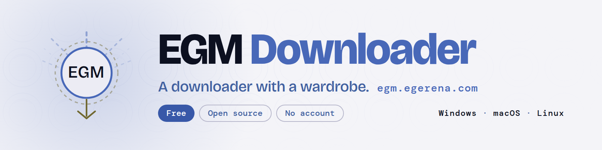
  </picture>
  
  

    
    
    
    
    
    
    
    
    
    
    
    
    
  

  
<strong>A powerful, multi-platform video and audio downloader for 1000+ websites.</strong>

  
  
Download videos or extract audio from YouTube, TikTok, Instagram, Twitter, Facebook, and hundreds of other platforms with a beautiful, easy-to-use interface.

  
<em>Powered by yt-dlp · runs locally · no cloud · no tracking · no accounts</em>

---

  <a href="#-download">⬇ Downloads</a> ·
  <a href="#screenshots">📸 Screenshots</a> ·
  <a href="#system-requirements">📋 Requirements</a> ·
  <a href="https://egerena.com/apps/egm-downloader.html">🌐 Website</a> ·
  <a href="https://x.com/EGMDownloader">🐦 @EGMDownloader</a>

## ✨ Features

- 🌐 **1000+ Supported Sites** - Download from YouTube, TikTok, Instagram, Twitter, Vimeo, and more
- 🔒 **Privacy First** - Runs entirely on your machine. No account required, no cloud processing, no analytics, and no usage tracking. Site cookies are handled locally and never pass through our servers.
- 🖥️ **Cross-Platform** - Native apps for Windows, macOS, and Linux
- 🎬 **Video & Audio Downloads** - MP4, MKV, or MP4 H.264 (max compatibility) video; MP3, M4A, OPUS, or FLAC audio
- 📊 **Quality Selection** - Video up to 8K/4K/2K/1080p; audio up to FLAC or 320 kbps MP3
- 🌈 **HDR Downloads** - Videos with HDR10, HDR10+, HLG, or Dolby Vision show as a separate option per resolution; saves as MKV to preserve HDR data untouched
- 📋 **Playlist Support** - Download entire playlists with one click
- ➕ **Add While Downloading** - Paste more links while downloads are running. New videos join the list and the current run, Clear keeps the downloads in progress, and one progress bar with a Cancel All button covers them all.
- 🔴 **Live Stream Recording** - Live streams show a LIVE tag with recording time and size. "Stop and save" ends the recording and keeps what was captured, and a recording that fails partway is saved instead of lost.
- 🔁 **Live Stream Reconnect** - If a live stream drops, the recording reconnects on its own (up to 5 times in a row) and joins the pieces into one file. A notice tells you when a few seconds may be missing or repeated.
- 📡 **Subscriptions** - Save channels and playlists, auto-fetch new videos, and download with per-channel settings and a live download queue
- 🚫 **SponsorBlock** - Optionally cut sponsor reads, self promotion, intros and outros out of downloaded YouTube videos, using the community [SponsorBlock](https://sponsor.ajay.app/) database. Off by default; choose categories globally or per subscription.
- 🔤 **Subtitles & Metadata** - Embed subtitles and rich metadata (thumbnail, chapters, title/artist/date) directly into video files
- ⚡ **GPU-Accelerated Conversion** - Video conversion and Upscale use your GPU when available, cutting CPU load and heat dramatically; falls back to software encoding automatically
- 📐 **Upscale to Quality** - Opt-in upscaling proportionally scales videos smaller than your chosen quality preset after download; off by default, adds pixels not detail
- 🌍 **10 Languages** - English, Arabic, German, Spanish, French, Italian, Japanese, Dutch, Portuguese, and Russian — auto-detected from your system, changeable anytime from the footer
- ↔️ **Native Right to Left** - Arabic reads right to left with the whole layout mirrored: panels, menus, progress bars, buttons and windows. Web addresses and file paths stay left to right.
- 🎨 **500 Themes** - 470 permanent across 32 categories + 30 seasonal themes that rotate throughout the year. If you see fewer than 500, seasonal themes appear during their respective time of year.
- 🎨 **Theme Creator** - Build your own theme with 10 live-preview color pickers, export as `.json`, save directly to your library, favorite alongside built-in themes
- 🖱️ **Drag & Drop + Keyboard Shortcuts** - Drop URLs directly into the app; Ctrl+V / ⌘V fetches, Ctrl+Enter / ⌘Return starts, Esc clears
- 📜 **Download History** - Track all downloads with search, filter, and re-download capability
- 💼 **Settings Export / Import** - Back up and restore your settings and subscriptions, including each subscription's own download folder, format, quality, auto fetch and SponsorBlock settings
- 🔄 **Auto-Updates** - Built-in update checker with SHA256 checksum verification (Windows/Mac)
- 🛠️ **Plugin Updates** - Update yt-dlp, ffmpeg, and optional libraries without reinstalling
- 💼 **Windows Portable** - Run from any folder or USB drive — no installer, no registry, downloads its own embedded Python on first run
- 📋 **Diagnostics** - Live diagnostic log viewer, available from the footer and the Subscriptions window, with optional raw yt-dlp output and export to file for troubleshooting
- 🧹 **Smart Cleanup** - Automatic removal of temporary files and failed downloads
- ⏱️ **Quit When Done** - Close the app automatically once every download has finished. A 30 second countdown appears in the middle of the window, and you can stop it with the Cancel button or the Esc key. Works from the main window and the Subscriptions queue, and won't close if a download failed or was cancelled.

## 🔍 How EGM Downloader compares

A side by side look at one well known alternative, using details you can check yourself on its official pages and in our source. Last checked October 13, 2026.

| | EGM Downloader | [4K Video Downloader+](https://www.4kdownload.com/products/videodownloader-42) |
|---|---|---|
| **Price** | Free. No paid tier, no license key | Free plan "with quantity limitations". Paid plans from $15/year ([product page](https://www.4kdownload.com/products/videodownloader-42)) |
| **Source code** | Public under AGPL-3.0 ([LICENSE](LICENSE)) | Proprietary. Terms: "We reserve all our rights over our Proprietary Materials." These include "software, scripts, source code" ([terms, section 3](https://www.4kdownload.com/agreement/videodownloader)) |
| **Videos behind a login** | Included. Import cookies from your browser, they stay on your machine | Premium: "private content download is a premium feature" ([product page](https://www.4kdownload.com/products/videodownloader-42)) |
| **What the app sends out** | No analytics or tracking code. It connects to the sites you download from, plus a short list of hosts for updates and its tools (GitHub, PyPI, egerena.com and an ffmpeg mirror), listed in the [source](app.py). On Windows, first run also installs its runtimes: Node.js (nodejs.org), Electron (npm registry and GitHub, fetched again when an app update needs a newer one) and, for the portable, Python (python.org) and pip (files.pythonhosted.org), listed in [windows/launch.py](windows/launch.py). | Terms: "we may collect and use anonymous technical data and related information … that is gathered periodically to facilitate the provision of updates to the Application." ([terms, section 9](https://www.4kdownload.com/agreement/videodownloader)) |
| **Platforms** | Windows 10/11 (needs Python 3.11+), macOS 13+ (Apple Silicon only), Linux AppImage | Windows 11, macOS 12+, Ubuntu 22.04+ (GNOME only) ([product page](https://www.4kdownload.com/products/videodownloader-42)) |

---

## 🖼️ Screenshots and videos

https://github.com/user-attachments/assets/ef67937c-2f11-4e28-95ca-62f168f194a0

https://github.com/user-attachments/assets/7d02363a-2c88-47c1-8807-8403a2979d48

> 📸 *Screenshots of v1.5.0.0.5, CITIUS · أصيل. The UI is identical across Windows, macOS, and Linux.*

<table>
  <tr>
    <td align="center" width="33%">
      <a href="screenshots/01-splash-screen.png">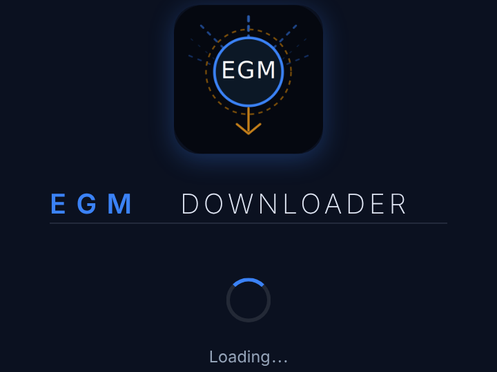</a>
       <b>Splash Screen</b>
    </td>
    <td align="center" width="33%">
      <a href="screenshots/02-main-ui.png">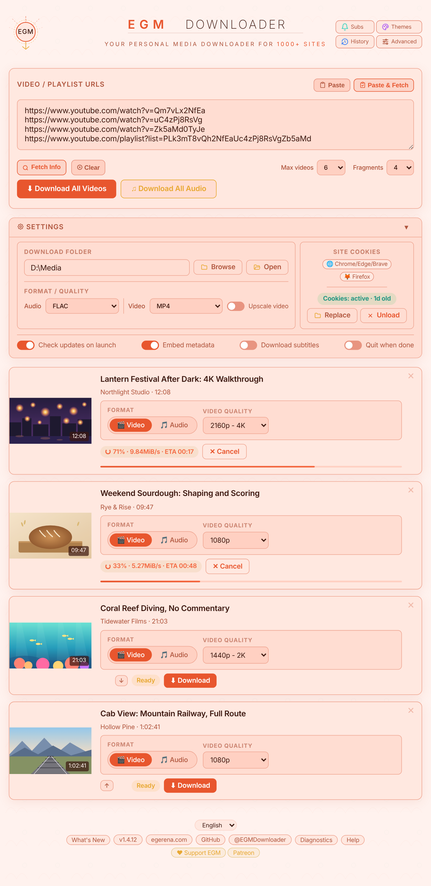</a>
       <b>Main UI</b> (Arabic, Meadow theme)
    </td>
    <td align="center" width="33%">
      <a href="screenshots/03-advanced-panel.png">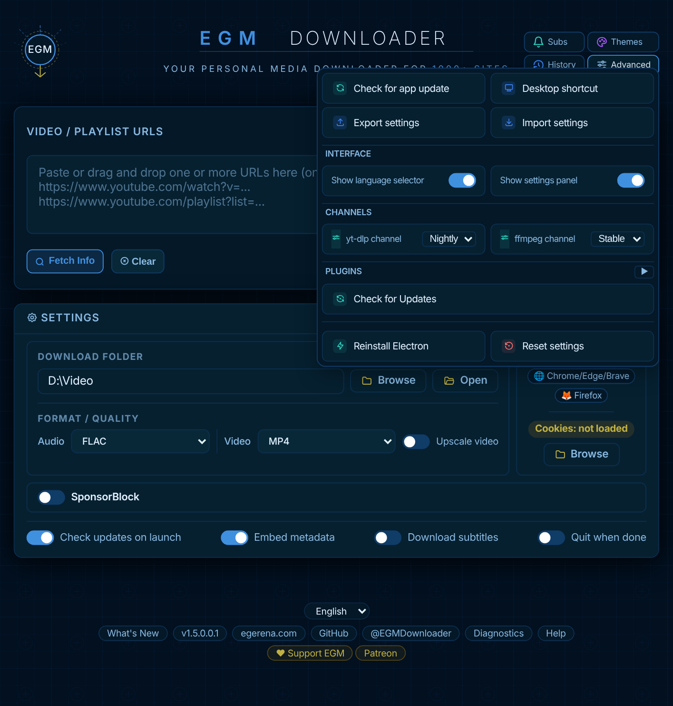</a>
       <b>Advanced Panel</b> (Arabic, Miami theme)
    </td>
  </tr>
</table>

<table>
  <tr>
    <td align="center" width="50%">
      <a href="screenshots/08-live-streams.png">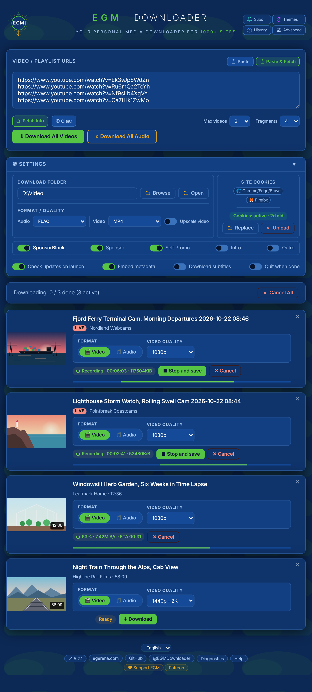</a>
       <b>Live Streams</b> (Northern Lights theme)
    </td>
    <td align="center" width="50%">
      <a href="screenshots/09-live-reconnecting.png">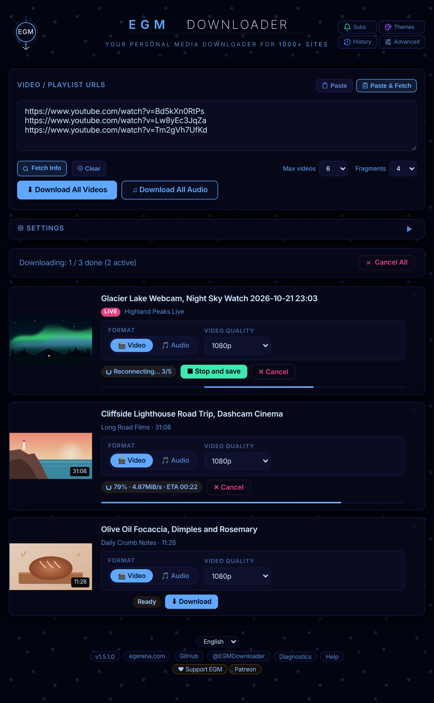</a>
       <b>Live Stream Reconnecting</b> (Holographic theme)
    </td>
  </tr>
</table>

<table>
  <tr>
    <td align="center" width="50%">
      <a href="screenshots/10-quit-when-done.png">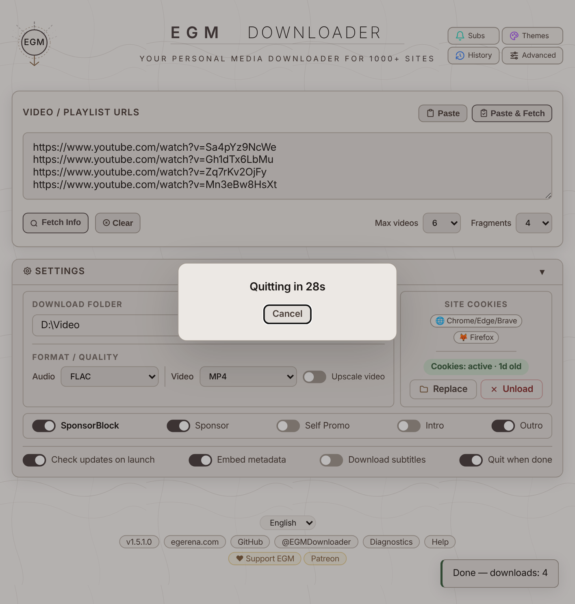</a>
       <b>Quit When Done</b> (Polaroid theme)
    </td>
    <td align="center" width="50%">
      <a href="screenshots/06-advanced-plugins.png">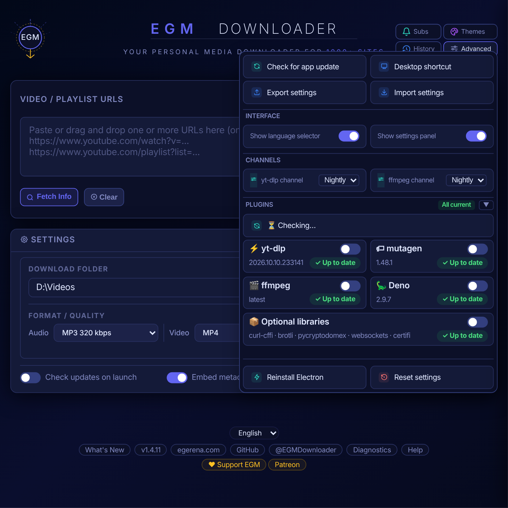</a>
       <b>Advanced Panel, Plugins</b> (Lilac Mist theme)
    </td>
  </tr>
</table>

<table>
  <tr>
    <td align="center" width="50%">
      <a href="screenshots/04-all-themes.png">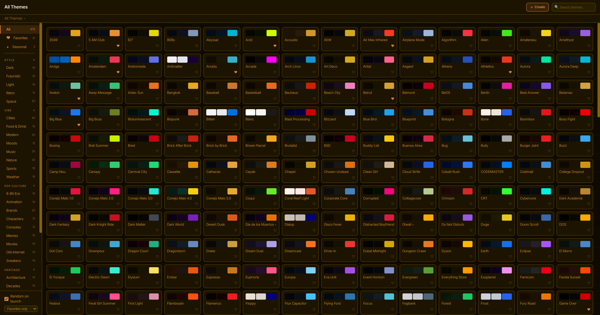</a>
       <b>All Themes</b> (Monsoon theme)
    </td>
    <td align="center" width="50%">
      <a href="screenshots/11-theme-creator.png">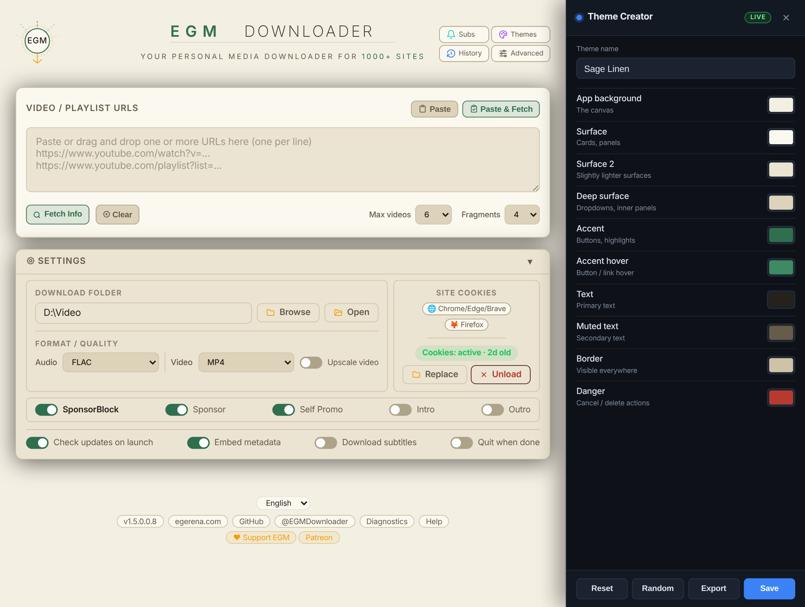</a>
       <b>Theme Creator</b> (custom Copper Tide theme)
    </td>
  </tr>
</table>

<table>
  <tr>
    <td align="center" width="50%">
      <a href="screenshots/05-subscriptions.png">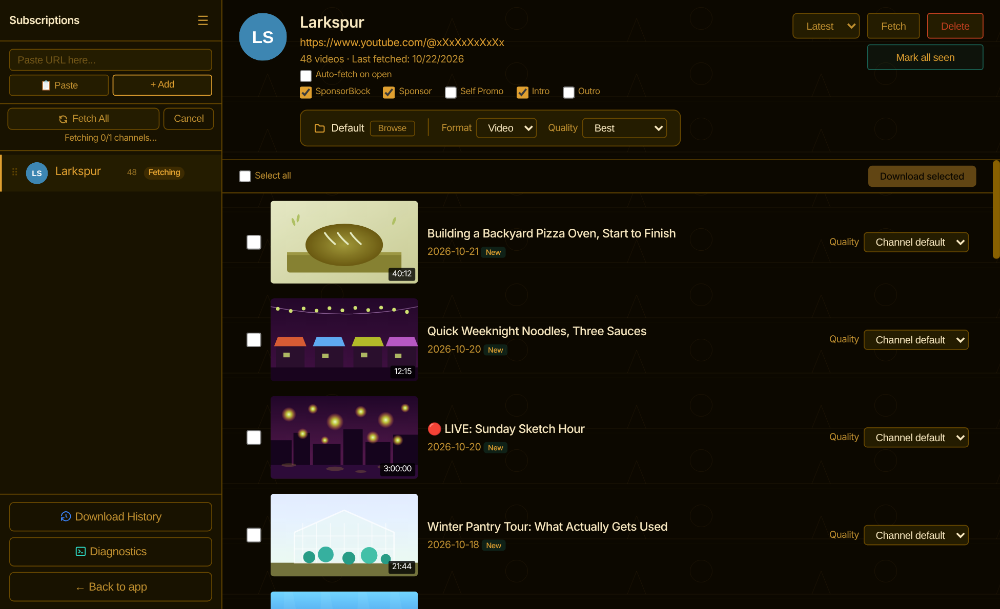</a>
       <b>Subscriptions</b> (Arabic, Favela Sunset theme)
    </td>
    <td align="center" width="50%">
      <a href="screenshots/07-download-history.png">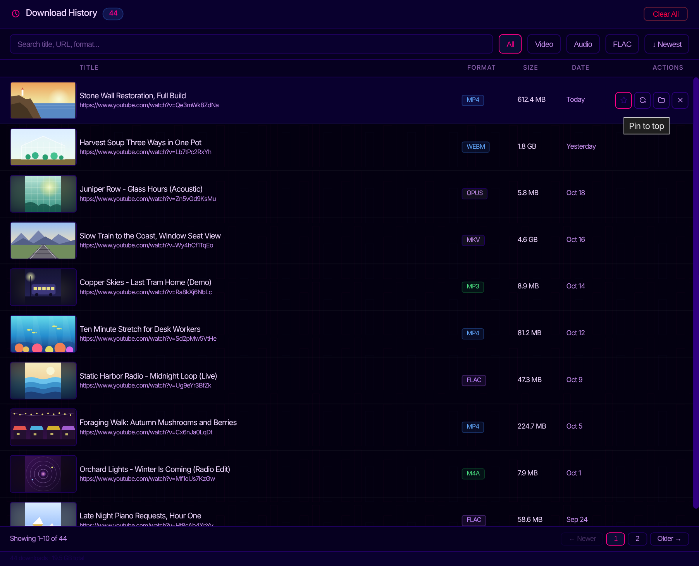</a>
       <b>Download History</b> (Permafrost theme)
    </td>
  </tr>
</table>

## 📥 Download

### Windows
🔗 **Platform page:** [windows.egerena.com](https://windows.egerena.com)
**Latest:** v1.5.0.0.5  
**Download:** [EGMd.zip](https://egerena.com/apps/EGMd.zip) (669 KB · ~800 MB after install)  
**SHA256:** `383e53790a4b5469f815c455a74a7ce00be6b52b42ba76a5f53ea869eb4e1cef`  
**Install:** Extract `EGMd.zip`, run `egm-setup.exe` and follow the installer. Then paste a video URL, fetch the info, and click Download.  
**Requirements:** Windows 10/11 (64-bit) · **Python 3.11+** — install from [python.org](https://www.python.org/downloads/) and tick "Add Python to PATH"  
**Code Signed:** Installer is signed with an IV code signing certificate. SmartScreen may show a warning on first run until the certificate builds reputation.
**Auto-Update:** ✅ Built-in update checker with SHA256 verification

### Windows Portable
**Latest:** v1.5.0.0.5  
**Download:** [EGMd-portable.zip](https://egerena.com/apps/EGMd-portable.zip) (675 KB · ~1 GB after first run)  
**SHA256:** `c7aa4cb4dfa41e5dece643dde16c71e739595ba8053466016c45badd5adbd739`  
**Install:** Extract `EGMd-portable.zip` and run `EGM Downloader.exe`. Settings and data stay in the same folder, so you can take it anywhere.  
**Requirements:** Windows 10/11 (64-bit) · **Python 3.10+** — install from [python.org](https://www.python.org/downloads/) and tick “Add Python to PATH”  
**No installer, no registry** — runs from any folder or USB drive (system Python 3.10+ is used only to bootstrap; the app then downloads a private embedded Python and runs on that. Node, Electron, ffmpeg & Deno are fetched on first run, and a newer Electron after an app update that needs one)  
**Code Signed:** Portable is signed with an IV code signing certificate. SmartScreen may show a warning on first run until the certificate builds reputation.
**Auto-Update:** ❌ Manual — check the [releases page](https://github.com/egmtm/EGM-Downloader/releases)

### macOS
🔗 **Platform page:** [mac.egerena.com](https://mac.egerena.com)
**Latest:** v1.5.0.0.5  
**Download:** [EGMdM.zip](https://egerena.com/apps/EGMdM.zip) (143 MB · ~300 MB after install)  
**SHA256:** `0e1872fc95300a062b4c3bfcff17913bb776b4a4b9bcc247b4340e1e143de0fb`  
**Install:** Extract `EGMdM.zip`, open the `.dmg`, drag "EGM Downloader" to Applications, and launch it.  
**Requirements:** macOS 13.0 (Ventura) or later · Apple Silicon (M1–M5) only  
**Signed & Notarized:** This build is Apple notarized — runs without Gatekeeper warnings
**Auto-Update:** ✅ Built-in update checker with SHA256 verification

### Linux
🔗 **Platform page:** [linux.egerena.com](https://linux.egerena.com)
**Latest:** v1.5.0.0.5  
**Download:** [EGMdL.zip](https://egerena.com/apps/EGMdL.zip) (171 MB · ~300 MB after install)  
**SHA256:** `acd30c3f1a0c7adfe9375abee9e59987bddb465d27c8b6d55c2ce52b2bd060b1`  
**Install:** Extract `EGMdL.zip`, make it executable with `chmod +x "EGM Downloader.AppImage"`, then double-click to launch (or run it from a terminal).  
**Format:** AppImage (Universal)  
**Supported Distros:** Ubuntu 20.04+, Mint 20+, Pop!_OS, Fedora 39+, Arch, and more
**Auto-Update:** ❌ Manual — check the [releases page](https://github.com/egmtm/EGM-Downloader/releases)

**First launch:** On Windows, the installer downloads runtime components (Node.js, Electron, ffmpeg) into your user data directory. Electron alone is about 250 MB, so the whole Windows first launch download is several hundred MB. After an app update that needs a newer Electron, the new one is downloaded next to the current one and only switched in once it works. If the download fails or you are offline, a point update keeps the current Electron and tries again at the next launch. macOS and Linux bundle Electron and Python inside the package, which is why their file sizes are larger, and download ffmpeg in the background on first launch. On all platforms the app also downloads Deno (a JavaScript runtime that improves YouTube quality) in the background.

### What's inside each download

| Download | Contents | Start with |
|---|---|---|
| `EGMd.zip` (Windows installer) | `egm-setup.exe`, `instructions.txt`, `LICENSE` | `egm-setup.exe` |
| `EGMd-portable.zip` (Windows portable) | `EGM Downloader.exe`, `instructions.txt`, `LICENSE`, `patchnotes.txt`, the `languages` folder, and the app's own files (`app.py`, `launch.py`, `.portable`, and the `electron`, `static` and `templates` folders), which are hidden after the first run to keep the folder tidy | `EGM Downloader.exe` |
| `EGMdM.zip` (macOS) | `EGM Downloader.dmg`, `INSTRUCTIONS.txt`, `LICENSE` | `EGM Downloader.dmg` |
| `EGMdL.zip` (Linux) | `EGM Downloader.AppImage`, `INSTRUCTIONS.txt`, `LICENSE` | `EGM Downloader.AppImage` |

Every download comes from egerena.com. The GitHub release pages carry the notes and link there. Check your zip against the SHA256 listed above.

---

### ⚙️ System Requirements

**Windows:** Windows 10/11 (64-bit) · ~1 GB disk space · Internet on first launch

**macOS:** macOS 13.0+ (Ventura) · Apple Silicon (M1–M5) · ~300 MB disk space · Internet on first launch (ffmpeg and Deno download)

**Linux:** 64-bit distribution · ~300 MB disk space · FUSE support · Internet on first launch (ffmpeg and Deno download)
Supported: Ubuntu 20.04/22.04/24.04/26.04, Mint 20/21/22, Pop!_OS 22.04, Zorin 16/17, elementary 7, Debian 11/12, KDE Neon, Fedora 39/40/41, openSUSE Leap 15.5/Tumbleweed, Rocky/AlmaLinux 9, Arch, Manjaro, EndeavourOS
> Ubuntu 22.04+ may require `libfuse2`: `sudo apt install libfuse2`

---

## 💡 Usage

1. **Paste URL** - Copy any video URL and paste it into the app, then click "Fetch". You can also use "Paste & Fetch" to paste and fetch in one step.
2. **Select Format** - Choose video (MP4, MP4 H.264, or MKV) or audio (MP3, M4A, OPUS, or FLAC). MP4 H.264 is the default — maximum compatibility everywhere.
3. **Select Quality** - Choose resolution (up to 8K) or audio bitrate
4. **Edit Filename** (Optional) - Click the filename to customize it
5. **Download** - Click the download button and wait for completion
6. **Open Folder** - Click "Open Folder" to view your downloaded files

### Advanced Features

- **Playlists:** Paste a playlist URL, choose "Download All" (or pick specific videos), then a resolution. "Download All Audio" does the same with your preferred bitrate. Items are processed in sequence.
- **Batch downloads:** Queue multiple URLs, set format and quality for each, start them together, and cancel any individual download anytime.
- **Plugin updates:** "Update Plugins" in the Advanced panel updates yt-dlp (newest site support) and ffmpeg (latest codecs).
- **Cookies / login-required content:** For premium or age-restricted content, import cookies from Chrome, Edge, Brave, or Firefox in the app. They stay on your machine and are never transmitted.
- **Subscriptions:** Follow YouTube channels and playlists and fetch new videos automatically, with per-channel folder, format, and quality settings and one download queue across all channels.
- **Theme Creator:** Press Ctrl+K anywhere in the app. 10 live-preview color pickers recolor the UI in real time; export as `.json` or save to your library.

---

## 🗺️ Roadmap

### Next: v1.6 · [redacted]

- 🔒 [redacted]
- 🎨 100 new themes
- ⚡ Electron 46
- More to be announced

*Plans can change. This list is updated as things are locked in.*

---

## 📖 The Origin Story

EGM Downloader started with [ReClip](https://github.com/averygan/reclip) by [@averygan](https://github.com/averygan), which showed what's possible with yt-dlp and a clean web interface. ReClip is a web app you host yourself, which suits developers, but I wanted something friends and family could use without a terminal. Setting up Python, yt-dlp, ffmpeg and Flask isn't everyone's cup of tea.

So I asked: what if you could just download an app and go? No terminal, no command line setup. That's EGM Downloader: native desktop apps for Windows, macOS, and Linux that need zero technical knowledge.

**What changed since ReClip**

ReClip is the starting point, and it is intentionally small. Here is what this project added on top, using details you can check in both repos. Last checked October 13, 2026.

| | [ReClip](https://github.com/averygan/reclip), where it started | EGM Downloader today |
|---|---|---|
| **Setup** | Install yt-dlp and ffmpeg, clone the repo and run `./reclip.sh`, or build the Docker image ([Quick Start](https://github.com/averygan/reclip#quick-start)) | Download the installer, portable zip, DMG or AppImage and open it. Windows needs Python first (3.11+ for the installer, 3.10+ for the portable zip); macOS and Linux bundle Electron and Python and fetch ffmpeg and Deno on first launch |
| **How you use it** | A local web server you start yourself, then open `localhost:8899` in a browser ([Quick Start](https://github.com/averygan/reclip#quick-start)) | A native desktop app window, nothing to start |
| **Platforms** | Install commands for Homebrew or apt, or a Docker image ([Quick Start](https://github.com/averygan/reclip#quick-start)) | Windows 10/11, macOS 13+ (Apple Silicon), Linux AppImage |
| **Formats and quality** | MP4 video or MP3 audio, resolution picker ([Features](https://github.com/averygan/reclip#features)) | MP4, MKV or H.264 MP4 video; MP3, M4A, OPUS or FLAC audio; up to 8K, HDR kept as MKV |
| **Login required content** | Not built in ([source](https://github.com/averygan/reclip/blob/main/app.py)) | Import cookies from Chrome, Edge, Brave or Firefox, kept on your machine |
| **Subtitles and metadata** | Not built in ([source](https://github.com/averygan/reclip/blob/main/app.py)) | Embed subtitles, thumbnail, chapters and metadata |
| **Beyond single downloads** | Bulk paste of URLs, files saved to a downloads folder ([Features](https://github.com/averygan/reclip#features)) | Subscriptions with a live download queue, searchable history, GPU conversion, 10 languages, 500 themes (30 seasonal) |
| **Staying current** | `reclip.sh` updates yt-dlp on every start ([script](https://github.com/averygan/reclip/blob/main/reclip.sh)) | In app updates for yt-dlp and ffmpeg, plus an app update checker |

ReClip stays deliberately small: a [single Python file backend](https://github.com/averygan/reclip#features), [two dependencies](https://github.com/averygan/reclip#stack) and an [MIT license](https://github.com/averygan/reclip/blob/main/LICENSE). EGM Downloader trades that simplicity for more features and a bigger download (143 MB on macOS, 171 MB on Linux).

Big thanks to [@averygan](https://github.com/averygan) for ReClip, you sparked the idea that became this project. 🙏 This is my first major project, and I'm excited to keep learning and building tools that make technology accessible to everyone. 🚀

---

## 🤖 AI Disclosure

EGM Downloader is built by one developer working with AI tools. They help with code, tests, documentation, translations and design assets. Everything that ships is reviewed and approved by a human, and the full source is open for anyone to inspect.

---

## ⚖️ Legal & Responsible Use

EGM Downloader is a tool for downloading video content from the internet. While the software itself is legal, **you are responsible for how you use it.**

### Legitimate Uses

This tool is designed for lawful purposes, including:
- Downloading your own content
- Downloading Creative Commons or public domain content
- Fair use purposes (education, research, criticism, commentary)
- Archiving content you have permission to download
- Backing up content you own or have rights to
- Offline viewing in jurisdictions where personal downloading is legal

### Your Responsibilities

When using this tool, you must:
- **Respect copyright laws** - Only download content you have the right to download
- **Follow Terms of Service** - Many platforms prohibit downloading; check their policies
- **Obtain permission** - When required by law or platform rules
- **Use responsibly** - Do not redistribute, sell, or commercially exploit downloaded content without proper rights

### Disclaimer

**This tool is provided "as-is" for personal, lawful use only.**

The developers:
- Do not encourage or condone copyright infringement
- Are not responsible for how users choose to use this software
- Do not provide legal advice regarding what you can or cannot download
- Assume no liability for user actions or violations of third-party terms

**You are solely responsible for ensuring your use complies with applicable laws, regulations, and terms of service.**

If you're unsure whether your use case is legal, consult a legal professional in your jurisdiction.

---

## 🛠️ For Developers

See [CONTRIBUTING.md](CONTRIBUTING.md) for the project structure, complete build guide, version management workflow, and CI details.

---

## 🏗️ Built With

EGM Downloader is powered by incredible open source projects:

- **[yt-dlp](https://github.com/yt-dlp/yt-dlp)** - Download engine (1000+ sites)
- **[bgutil-ytdlp-pot-provider](https://github.com/Brainicism/bgutil-ytdlp-pot-provider)** - YouTube PO Token generation (proof-of-origin)
- **[yt-dlp/ejs](https://github.com/yt-dlp/ejs)** - EJS remote components for YouTube signature solving
- **[curl_cffi](https://github.com/lexiforest/curl_cffi)** - Browser TLS impersonation for yt-dlp — enables downloads from sites that fingerprint HTTP clients
- **[Flask](https://flask.palletsprojects.com/)** - Web framework
- **[Electron](https://www.electronjs.org/)** - Cross-platform desktop wrapper
- **[FFmpeg](https://ffmpeg.org/)** - Video/audio processing
- **[Deno](https://deno.com/)** - JavaScript runtime for YouTube tokens
- **[mutagen](https://mutagen.readthedocs.io/)** - Audio metadata tagging (thumbnail, chapters, title/artist/date)

See [CREDITS.md](CREDITS.md) for complete acknowledgments and licenses.

---

## 📜 License

This project is licensed under the **GNU Affero General Public License v3.0 (AGPL-3.0)** — see the [LICENSE](LICENSE) file for details.

Copyright (c) 2024-2026 EGM

This program is free software: you can redistribute it and/or modify it under the terms of the GNU Affero General Public License as published by the Free Software Foundation, either version 3 of the License, or (at your option) any later version.

This program is distributed in the hope that it will be useful, but WITHOUT ANY WARRANTY; without even the implied warranty of MERCHANTABILITY or FITNESS FOR A PARTICULAR PURPOSE. See the GNU Affero General Public License for more details.

You should have received a copy of the GNU Affero General Public License along with this program. If not, see <https://www.gnu.org/licenses/>.

- ✅ Free to use, modify, and distribute under AGPL-3.0 terms
- ✅ Modification and distribution allowed (must share modifications + source)
- ⚠️ Network use triggers copyleft

---

## 📞 Support & Security

- 🐛 **Bug Reports / Feature Requests:** [Open an Issue](https://github.com/egmtm/EGM-Downloader/issues)
- 🛠️ **Troubleshooting:** The instructions file included with each download covers the common fixes. Still stuck? Open an issue.
- 🐦 **Updates & Announcements:** [@EGMDownloader](https://x.com/EGMDownloader) on X
- 📖 **Contributing:** [Read CONTRIBUTING.md](CONTRIBUTING.md)
- 🔒 **Security Vulnerabilities:** Do not open a public issue — email contact@egerena.com or use [GitHub's private vulnerability reporting](https://github.com/egmtm/EGM-Downloader/security/advisories/new). We aim to respond within 48 hours.
